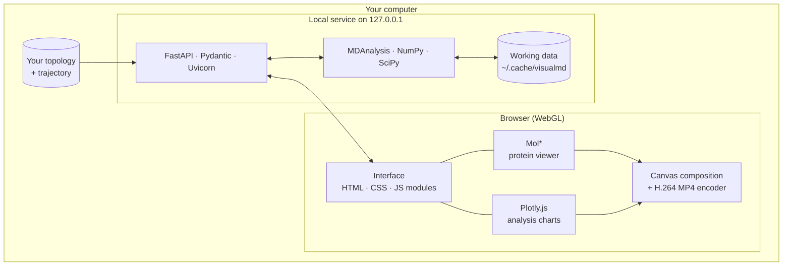
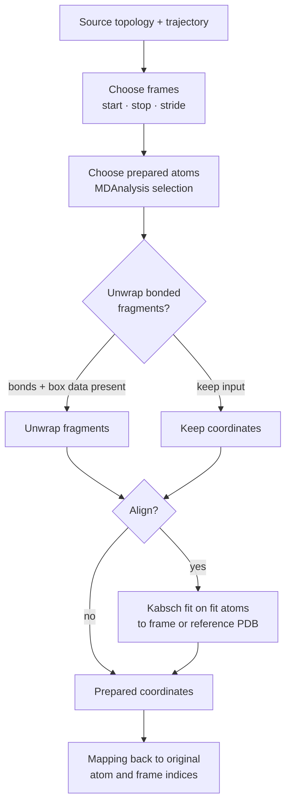

# VisualMD documentation

**Applies to:** VisualMD `v0.2.1-preview` for Linux x86_64  
**Updated:** 9 November 2026  
**Audience:** People exploring protein structures and molecular-dynamics trajectories, from first-time viewers to researchers who need to inspect, analyse and export results.

VisualMD combines a molecular viewer, trajectory playback and linked analyses in one local browser workspace. The application runs on your Linux computer. The [public website](https://visualmd.pages.dev/) is a preview and download page; it does not process your trajectories. This is a preview release, so read the [current limitations](#current-preview-limitations) before using results in a scientific report.

New here? Go to [Download, install, and launch](#download-install-and-launch), then [Your first exploration](#your-first-exploration).

## Contents

1. [How VisualMD works](#how-visualmd-works)
2. [What you need](#what-you-need)
3. [Download, install, and launch](#download-install-and-launch)
4. [Your first exploration](#your-first-exploration)
5. [Input files and formats](#input-files-and-formats)
6. [Prepare a trajectory correctly](#prepare-a-trajectory-correctly)
7. [Explore the structure and playback](#explore-the-structure-and-playback)
8. [Run and interpret analyses](#run-and-interpret-analyses)
9. [Export images, video, and data](#export-images-video-and-data)
10. [Save and reopen a workspace](#save-and-reopen-a-workspace)
11. [Large files, limits, and storage](#large-files-limits-and-storage)
12. [Privacy, licensing, and data lifetime](#privacy-licensing-and-data-lifetime)
13. [Troubleshooting](#troubleshooting)
14. [Frequently asked questions](#frequently-asked-questions)
15. [Current preview limitations](#current-preview-limitations)
16. [Project, testing, and feedback](#project-testing-and-feedback)

---

## How VisualMD works

VisualMD is a browser interface talking to a scientific service on **your own computer**. Nothing about your trajectory goes to the public website.



| Layer | Technology | Job |
| --- | --- | --- |
| Interface | HTML5, CSS3, JavaScript ES modules, a small TypeScript contracts file | Layout, controls, shared frame and residue state. No React or Vue framework. |
| Molecular view | Mol\* 4.18.0 | Structures, representations, surfaces, camera, frame display |
| Charts | Plotly.js 3.0.1 | Linked plots, 2D/3D PCA, 2D/3D free-energy landscapes |
| Export | Canvas composition, bundled H.264 MP4 encoder | PNG and MP4 for protein, plot, split view and Legend view |
| Local API | FastAPI 0.162.0, Pydantic 2.14.3, Uvicorn 0.54.0 | Receives files, runs preparation and analyses, serves frames |
| Science | MDAnalysis 2.11.0, NumPy 2.5.4, SciPy 1.18.1 | Reading formats, selections, alignment, numerical analyses |
| Runtime | Bundled CPython 3.14, pinned wheels | Lets users run without installing Python or Node.js |

Versions are those pinned in the `0.2.1` runtime lock.

The workflow, end to end:

1. **Inspect.** VisualMD reads your files and reports atoms, residues, frames and warnings, without changing anything.
2. **Prepare.** Your source files are turned into separate working coordinates (frame range, stride, atoms, optional unwrapping and alignment). Originals are never rewritten, and every retained frame and atom keeps a mapping back to its original index.
3. **Explore.** The protein panel and analysis panel share the current frame and residue highlight.
4. **Analyse.** You run analyses on atoms inside the prepared set.
5. **Export or save.** PNG, MP4, CSV/JSON, selected-frame PDB, or a portable `.visualmd` session.

### Launch model

- The release archive contains its own managed CPython 3.14 and pre-built browser assets.
- `./install.sh` downloads the **pinned scientific wheels** once, which is why the first install needs internet. After a successful install, the author verified normal use offline.
- The installer creates a `visualmd` command that is a **link to the launcher inside the extracted folder**. Moving or deleting that folder breaks the command; `./visualmd` from inside the folder always works.
- Each launch picks a **fresh free port** on `127.0.0.1` and opens your browser there. This avoids showing an older instance still running on a fixed port such as 8000.
- The service listens on the loopback interface only, so other devices on your network cannot reach it.
- Node.js and npm (Node 24.22.2, Vite 6.4.5) are the author's build tools. End users never need them.

## What you need

| Requirement | Current preview |
| --- | --- |
| Operating system | **Linux x86_64**. Windows, macOS, ARM Linux, and a browser-only hosted analysis service are not released. |
| Disk space | Space for the archive and installation, plus your input files, a temporary uploaded copy, prepared coordinates, and at least **1 GiB free reserve** on the working drive. Large trajectories may need considerably more. |
| Internet | Required for the first `./install.sh`, which downloads pinned scientific packages. Ordinary use was verified offline by the author after installation. |
| Python or Node.js | Neither needs to be installed system-wide. The archive includes its Python runtime and built frontend. |
| Browser and graphics | A modern desktop browser with working WebGL/GPU support. Browser, GPU and distribution coverage is still being expanded. |
| Scientific inputs | A topology or structure file; add a matching trajectory for motion analysis. See [formats](#input-files-and-formats). |

No account is needed. The terminal that starts VisualMD must stay open while you work.

## Download, install, and launch

1. Open the [v0.2.1-preview release](https://github.com/Eswar-mse/visualmd/releases/tag/v0.2.1-preview). Download **both** `visualmd-linux-x86_64-0.2.1-preview.tar.gz` and its matching `.sha256` file into the same directory.
2. In that directory, verify the download and extract it:

   ```bash
   sha256sum --check visualmd-linux-x86_64-0.2.1-preview.tar.gz.sha256
   tar -xzf visualmd-linux-x86_64-0.2.1-preview.tar.gz
   cd visualmd-linux-x86_64-0.2.1-preview
   ./install.sh
   ```

3. Launch the app:

   ```bash
   visualmd
   ```

   The command selects a free local port, prints an address such as `http://127.0.0.1:PORT/`, and opens that page in your browser. Keep the terminal open. Press **Ctrl+C** there to stop the service.

If your shell says `visualmd: command not found`, run `./visualmd` from the extracted folder. The installer also prints instructions for adding `~/.local/bin` to `PATH`. **Keep the extracted folder** after installation.

SHA-256 recorded for this release archive: `1f88e39379f2b07755eee1a2ff870a69a9d3bf76d4cc5a16b323b502e392f5f5`. Prefer checking against the release's `.sha256` file as shown above.

### If installation does not finish

Run `./install.sh` again with an internet connection. Preserve the full error message if a scientific package reports that no compatible wheel is available. A successful install is required before offline use; the archive alone is not a completely offline installer.

### If the browser does not open

Copy the exact `http://127.0.0.1:.../` address printed by the launcher into a browser on the **same computer**. Do not assume the app is at port 8000. A phone or another computer on the network cannot connect in this preview.

## Your first exploration

The opening screen waits for you to choose **Explore the real demo**, **Open your files**, or **Reopen a saved session**. It never silently loads a trajectory.

### Try the bundled demo

Choose **Explore the real demo**. It uses the author's `demo.pdb` and `demo.xtc`: **290 residues, 4,640 atoms, and 5,001 source frames**. The demo prepares at **stride 5**, so the workspace retains **1,001 frames**, including the last source frame. You can play the trajectory, switch representations, run analyses and export visuals without supplying files.

The demo is real simulation data, but its detailed protocol, sampling quality and equilibrium status are not established in this release. Use its landscape as an exploratory visual, not as proof of thermodynamic convergence. The website preview uses a reduced version of the same demo (101 cartoon coordinate snapshots with selected analysis data).

### Open your own system

1. Choose **Open your files** or **Open trajectory**.
2. Select a topology/structure; optionally add a matching trajectory.
3. Choose **Inspect system** and review the reported atoms, residues, frames and warnings.
4. Set preprocessing, sampling method, frame range/stride, prepared atoms, residue-number correction if needed, and alignment reference.
5. Choose **Prepare and explore**. Run an analysis in the right panel to link measurements with the molecular view.

A structure alone can be viewed, but analyses that depend on motion need enough frames. The app does not infer a trajectory from a single PDB structure.

## Input files and formats

### Topology versus trajectory

The **topology** describes atoms and identities: atom names, residues, chains or segments, and sometimes bonds and masses. The **trajectory** supplies changing coordinates across frames. Both must describe the **same atoms in the same order**. A trajectory such as XTC does not, by itself, restore residue names or original biological numbering.

For a common GROMACS protein workflow, use a protein-only PDB that corresponds exactly to the trajectory's atoms together with its matching XTC. A full solvated PDB with a protein-only trajectory, or a protein-only PDB with a full-system trajectory, will fail or give a mismatched system. Verify atom count and ordering before interpreting any plot.

### Format status

| Input | Preview status |
| --- | --- |
| PDB topology + XTC | **Used by the author with real data**, including the bundled demo. |
| PDB topology + DCD | Covered by generated reader/writer/preparation tests. |
| Reference PDB (alignment) | Covered by tests. |
| Single-structure or multi-model PDB | Supported for appropriate viewing/testing workflows; trajectory analyses still need sufficient frames. |
| GRO, PSF, TPR, PRMTOP/PARM7, TOP, MOL2, PQR | Offered as MDAnalysis-compatible topology reader candidates. Real-file coverage varies. |
| TRR, NetCDF, MDCRD/CRD/TRJ and other listed trajectory variants | Offered as reader candidates. A recognised extension is not a guarantee that a particular file variant can be read. |

VisualMD supports a **growing set of MDAnalysis-compatible formats**. Many combinations still need representative real-file tests, and no variant is guaranteed. The upload dialog shows accepted extensions. Compatibility also depends on file content and on whether it supplies the metadata a selected analysis needs (bonds, hydrogens, masses, complete atom groups).

If a format fails, report the exact extension, producing program, error text, and a shareable minimal example through [Issues](https://github.com/Eswar-mse/visualmd/issues).

### Choosing the right structure

Choose a topology that retains the atoms you intend to view **and** analyse. The default prepared selection is `protein or nucleic`. If you intend to measure protein-ligand distances, include both receptor and ligand. If hydrogen-bond analysis needs hydrogens, prepare them too and use topology bonds when available. Atoms omitted at preparation cannot be added by an analysis selection later without preparing again.

## Prepare a trajectory correctly

Preparation creates separate working coordinates and records mappings back to your original atom and frame indices. It does **not** rewrite your source files.



### 1. Describe preprocessing and sampling

- **Preprocessing:** Raw trajectory, Already processed, or Not sure. This documents what you know about your input; it does not automatically make a broken molecule whole.
- **Sampling method:** Unbiased MD, Biased/enhanced sampling, or Not sure. VisualMD blocks an unweighted free-energy landscape for trajectories declared biased, because a valid reweighting method is not yet implemented.
- **Periodic boundaries:** Keep input coordinates, or choose **Unwrap bonded fragments** when the topology has explicit bonds and the trajectory has usable box data. Fragment unwrapping cannot determine the correct relative positions of separate protein chains or disconnected fragments. Check the result before interpreting global distances or motions.

### 2. Pick frames and atoms

**Start frame** is inclusive and **Stop** is exclusive; both refer to original source-frame indices. **Analysis stride** keeps every Nth frame. For example, `start 0`, `stop 100`, `stride 5` selects source frames 0, 5, …, 95. The demo retains source frame 5000 because it falls on the stride-5 sequence. The app reports the actual retained frame count before preparation.

Use an MDAnalysis atom-selection expression for **Prepared atoms**, for example `protein`, `protein or nucleic`, or `name CA`. The analysis panel has a separate **Atom selection** applied **within** the prepared atoms. Cα is often a good starting point for global motion; full heavy-atom or ligand analyses need a broader preparation.

Compressed file size does not equal expanded coordinate size. VisualMD previews the coordinate footprint for your selected atoms and frames, suggests a safe stride when needed, and asks you to review a replacement if your settings exceed a budget. A larger stride keeps fewer frames and changes the data available to every downstream analysis. See [Estimating storage](#estimating-storage).

### 3. Restore biological residue numbers if needed

Some tools reset residue IDs to 1. After inspection, **Restore residue numbers** can set the true first residue number for each chain/group. Leave a group blank to keep its file numbering. Existing gaps and insertion codes are preserved, but the tool cannot recover gaps erased from the topology.

Corrected numbers appear in plot labels and residue search. Search `file:1` in the residue picker to find original file ID 1. **Atom-selection expressions such as `resid 1:50` still use the topology's file numbers.** If you upload a separate reference PDB after applying a correction, its residue numbers must use the corrected numbering. JSON and the preparation manifest retain both file and reported mappings; CSV includes mapping information when a correction was applied. PDB's legacy numbering limits may require the viewer or frame export to keep display IDs, so retain the manifest alongside exported coordinates.

### 4. Choose an alignment reference

Alignment removes global translation and rotation so you can compare structural changes. Choose fit atoms, typically `name CA`, and either:

- **A trajectory frame:** enter an **original source-frame index**, even if stride would skip that frame.
- **Reference PDB:** supply a compatible single-model PDB. VisualMD checks chain/segment, residue number and insertion code, residue name, atom name and alternate location. Ambiguous or incomplete mapping **fails** rather than silently guessing.

The fit is an unweighted Kabsch alignment. Alignment does **not** repair periodic-boundary artefacts. If your trajectory is already fitted, choose settings that do not unintentionally change the meaning of your analysis. Results record the preparation settings and reference; source files remain unchanged.

### 5. Review the output

After preparation, check the system strip, visible residue count, first and last retained source-frame indices, warnings, and the structure itself. If the protein looks split, atoms look displaced, or counts differ from expectation, stop and fix the source pair or preparation settings before treating plots as scientific evidence.

## Explore the structure and playback

### Molecular viewer

Representations: **Cartoon, Ball and stick, Spacefill, Lines, Surface, Backbone, B-factor Putty, and Points**. Colour schemes: chain, element, sequence, secondary structure. Viewer backgrounds: black, midnight, white, theme-matched, custom or transparent, independent of the app's dark/light theme.

**Appearance** controls shadows, cavity shading and outlines. Surface geometry can be molecular, Gaussian envelope or wireframe. Finishes are Soft, Matte, Glossy, Glass, Frosted glass, Metallic and Clay. Glass is a translucent visual style, not physically accurate refraction. Quality choices are Fast, Balanced and Cinematic; Fast disables the heavier effects while preserving your saved preferences for when you switch back. These settings change the picture, never the analysis coordinates.

### Playback and linked views

Use Play/Pause, previous/next, the scrubber, speed and Loop below the protein. The protein and analysis panels share the **current frame** and the **residue highlight**:

- Clicking a point in a time plot, PCA cloud or sampled landscape selects its retained frame.
- RMSF and residue matrix plots can identify residues in the viewer.
- Some plots describe residues or aggregates rather than one frame; follow the interaction hint shown with each result.

The source index shown for a retained frame maps back to the original trajectory. Reader-supplied time can be inferred or unverified; check its timestep against your simulation files before reporting physical time.

### Residue selection and visibility

Use **Select residues** to search by residue name, number/insertion, chain or segment. Exact filters include `chain:A`, `name:GLY`, `resid:42A` and `segment:PROA`; combine filters to narrow the list. Tick residues, choose **Apply visibility**, and use **Show selected only** to toggle isolation. The list shows up to 300 rows initially and can reveal more; **Tick matches** handles up to 1,000 matching residues.

A surface for isolated residues is recalculated from visible atoms only, so hidden neighbours do not shape it. **Clear selection** removes highlights and restores all prepared residues.

### Viewer selection versus analysis selection

These are independent by design.

| | Residue picker (viewer) | Atom selection (Analysis studio) |
| --- | --- | --- |
| Controls | What is visible or highlighted in Mol\* | What an analysis computes on |
| Scope | Prepared atoms | Prepared atoms |
| Changes plots? | No | Yes, after you run again |
| Affects PNG/MP4 export? | Yes, exports show the visible subset | No |
| Affects selected-frame PDB? | No, it still contains all prepared atoms | No |

Isolating a pocket in the viewer does **not** restrict RMSD, PCA, SASA or any other analysis to that pocket. To change the calculation, update the analysis selection and run again; to include atoms omitted during preparation, prepare again.

### Layouts and shortcuts

- **Regular workspace:** resizable protein and analysis panels.
- **Focus view** (`F`): larger linked panels with compact plot controls. Run an analysis first if you want a plot displayed.
- **Legend view** (`L`): the protein fills the workspace and a frame-linked plot sits in a corner. It temporarily uses a black molecular background and restores your previous choice on exit. Run an analysis first.
- **Space:** play/pause. **Left/Right arrows:** step frames. **R:** reset camera. **Escape:** close a dialog or leave a transient view.

Shortcuts apply when the workspace has focus and should not interrupt text entry. Use the visible buttons if the browser or desktop intercepts a shortcut.

## Run and interpret analyses

In **Analysis studio**, select an analysis, set its atom selection (default `name CA` within prepared atoms) and any extra controls, then choose **Run analysis**. Completed results stay available as tabs or a compact selector. The plot download icon opens visual export; **Download CSV** and **Parameters + data** provide scientific data.

### Before you run anything

1. **Check the structure first.** Plots from a broken system are not scientific evidence.
2. **Atom selection works inside prepared atoms.** An analysis cannot use atoms you excluded at preparation.
3. **Stride changes the data.** Every analysis sees only retained frames.
4. **The viewer selection does not restrict analyses.**
5. **Alignment is a preparation choice.** RMSD uses prepared coordinates with **no second hidden fit**.

### Reference table

| Analysis | What it shows | Important interpretation or input note |
| --- | --- | --- |
| RMSD | Structural deviation over retained frames relative to the configured reference | No second hidden fit. Selected RMSD atoms must exist in the reference. |
| RMSF | Atomic fluctuations summarised by residue | Residue value is the arithmetic mean of the selected atomic RMSFs; a Cα selection gives one value per selected protein residue. |
| Radius of gyration | Compactness of the selected atoms across frames | Mass weighted. Coordinate-spread components are not separate axis radii of gyration. |
| PCA | Dominant Cartesian motion as a 2D or 3D point cloud | Unweighted; PC sign is arbitrary. Large atom selections can exceed the exact solver budget. |
| Free-energy landscape (FEL) | Occupancy-derived landscape in two selected PCs, 2D or 3D | Exploratory projection, not potential energy or proof of convergence. Blocked for biased sampling. |
| Residue-centre contacts | Contacts below a chosen cutoff | Geometric centres of selected atoms per residue, **not** minimum interatomic distance. |
| DCCM | Correlation of residue-centre displacement over sampled frames | Zero-variance entries are set to zero; sufficient frames and sensible alignment matter. |
| SASA | Solvent-accessible area, including residue averages | All prepared heavy atoms act as occluding context, so prepare broadly. Probe radius 1.4 Å. |
| Secondary structure | Three-state protein assignment (MDAnalysis DSSP) | Prepare complete protein atoms and check topology suitability. |
| Hydrogen bonds | Geometric donor-acceptor counts | Usually needs explicit hydrogens and bonds; distance-based donor-hydrogen inference is an explicit option. Default geometry: D-A ≤ 3.5 Å and D-H-A ≥ 150°. |
| Protein-ligand distances | Receptor-ligand heavy-atom minimum distances | Select a ligand explicitly and a **disjoint** receptor; both must have been prepared. |

### Reading PCA and FEL responsibly

PCA views use frame-coloured points without a line joining every frame, which would be misleading. Switching between 2D and 3D changes the view, not the PCA result.

The FEL is computed from projected occupancy as `−RT ln(P/Pmax)` and shown in kJ/mol. The temperature field **scales** that expression; it does not turn a trajectory into a newly sampled equilibrium ensemble.

- **Observed bins** shows the sampled histogram and leaves unsampled bins masked. **Smooth estimate** interpolates and can show values between sampled regions. Use observed bins and exported data to identify actually sampled locations.
- Basins are an operational partition around local minima, not proof of metastable states or kinetics.
- If your data are biased, select **Biased / enhanced sampling** and do not interpret an unweighted FEL.
- For ordinary or unknown MD, inspect equilibration, convergence, replicate agreement and preprocessing **independently** before making thermodynamic claims. VisualMD makes no automatic convergence claims.
- Use exported data, not only the picture, when quoting values or locations.

### Common analysis mistakes

| Mistake | Fix |
| --- | --- |
| Expecting residue isolation to change a plot | Change **Atom selection** in Analysis studio and run again |
| SASA on a Cα-only preparation | Prepare all heavy atoms |
| Ligand distances with no ligand prepared | Include receptor and ligand in prepared atoms |
| Hydrogen bonds with no hydrogens | Prepare hydrogens, or enable donor-hydrogen inference deliberately |
| FEL unavailable | Check the biased flag, frame count, and whether PCA fits the selection |
| Alignment used to fix a split molecule | Alignment does not repair periodic-boundary artefacts; fix wrapping first |
| Treating the FEL as potential energy | It is a projected occupancy estimate |

## Export images, video, and data

Use **Export visuals** in the header or the plot's download icon. Choose a composition:

- **Protein + analysis:** split view.
- **Protein + corner plot:** Legend-style composition.
- **Protein only** or **Analysis only**.

Choose PNG for a still of the current retained frame, or MP4 for a sequence. Output sizes are **1280 × 720** and **1920 × 1080**. MP4 uses an inclusive, **1-based retained-frame** first/last range, a frame stride, and **12, 24 or 30 fps**, with at most **600 sampled frames**. Video duration equals exported frame count divided by fps; it is presentation time, not simulation time. Rendering can take far longer than playback, and you can cancel. Afterward the camera and selected frame are restored and playback stays paused.

**Transparent PNG background** creates an image with alpha. The viewer shows a checkerboard for transparency; MP4 always has an opaque background. A visual file is a picture, not a reusable numeric dataset.

| You want | Use |
| --- | --- |
| A picture or video | PNG / MP4 |
| Reproducible numbers | **Download CSV** or **Parameters + data** (JSON, with settings and provenance) |
| One frame's coordinates | **Selected frame PDB**: all prepared atoms at that frame; may use display IDs if biological numbering exceeds PDB limits, so keep the manifest or JSON mapping |
| Continue later | `.visualmd` session (see below) |

A frame PDB is not a session bundle and is not a substitute for the original trajectory. These outputs are not interchangeable; keep all those relevant when archiving a result.

## Save and reopen a workspace

Open the folder/session control in the header and choose **Save portable session**. Keep the resulting `.visualmd` file in your own storage. To continue, choose **Reopen session** on the opening screen or the same control.

A session is a **recipe, not a snapshot of results**. It stores original topology/trajectory inputs, the prepared reference snapshot if used, preparation and analysis recipes, supported view settings, and version/provenance metadata. Reopening validates the archive and **recalculates** prepared coordinates and analyses using the installed libraries, then restores supported workspace settings and starts paused. It does **not** preserve exact old numerical arrays, so export CSV/JSON separately if you need the exact values. Restored results may differ if scientific dependencies changed.

Limits: **512 MiB compressed** and **1 GiB expanded** input data. A larger trajectory can still be explored, but **Save portable session** is disabled; keep the original files and export results separately. A linked-source workspace for huge inputs is future work. The current app reads session schema versions 1 to 5; an older app may not read a newer session.

## Large files, limits, and storage

The limits below are **admission limits**, not promises of smooth performance.

| Item | Limit |
| --- | --- |
| Trajectory upload (direct local transfer) | Up to **10 GiB** |
| Topology upload | Up to **512 MiB** |
| Free reserve on the working drive | At least **1 GiB** |
| Retained frames | Up to **30,000** |
| Prepared coordinates | Up to **12 GiB** |
| Preloaded in the browser | Up to about **320 MiB**; larger sets are disk-backed and fetched on demand at full detail |
| Target system size | Roughly **1,000 residues** (a target scenario, not a guarantee) |
| Portable session | 512 MiB compressed, 1 GiB expanded |
| Export | 1280 × 720 or 1920 × 1080; MP4 at 12/24/30 fps, at most 600 sampled frames |

The on-demand path keeps every selected atom but can make seeking, playback, surfaces, analyses and exports slower. Individual analyses have their own limits; dense selections and matrices may need fewer frames or atoms.

**Performance status:** a **synthetic** 30,000-frame API check has passed. A **real** 25,000-30,000-frame browser/GPU benchmark at full atom detail is **still open**. Legend PNG/MP4 export is confirmed on the author's workstation only.

### Estimating storage

One float32 XYZ coordinate array costs roughly:

```
bytes ≈ 12 × selected atoms × retained frames
```

This is before indexes, analysis arrays, caches and temporary files.

| Example | Bytes | Size |
| --- | --- | --- |
| 10,000 atoms × 5,000 frames | 600,000,000 | about **572 MiB** |
| Bundled demo: 4,640 atoms × 1,001 frames | 55,735,680 | about **53 MiB** |

Budget the working drive for: the temporary copy of your uploaded trajectory, prepared coordinates (when the on-demand path is used), the 1 GiB reserve, and analysis arrays and caches. If setup recommends a larger stride, weigh the scientific tradeoff rather than accepting it only for speed.

### Choosing a data folder

Working data defaults to `${XDG_CACHE_HOME:-$HOME/.cache}/visualmd`. To use a drive with more space, set this before launching:

```bash
VISUALMD_DATA_DIR=/path/to/large/drive visualmd
```

## Privacy, licensing, and data lifetime

**Privacy.** The service listens on **`127.0.0.1`**. Files opened in the released app are processed on your computer and are not uploaded to the public VisualMD website. Installation fetches Python dependencies; offline analysis is possible afterward on the author's tested Linux setup. There are no accounts, cloud synchronisation or remote collaboration in this preview.

**Data lifetime.** Temporary uploads and prepared sessions live under the working-data directory. Normal shutdown removes that run's temporary working sessions. A forced crash can leave files behind; automatic stale-run cleanup is not implemented yet. Keep your **original input files** and downloaded exports; temporary copies are not a backup. Avoid placing confidential inputs in public GitHub issues.

**License.** The released application is **free to use under the VisualMD Preview End User License**, including official unmodified releases for personal, educational, research and internal commercial use. It is **not open-source software**. Modification, redistribution, resale and offering VisualMD as a hosted service are restricted. Third-party components keep their own licenses; you retain rights to your own input data and outputs. Read `LICENSE.txt` inside the download for the governing terms.

**What is public.** The public repository [`Eswar-mse/visualmd`](https://github.com/Eswar-mse/visualmd) holds the static launch website (`site/`, with a reduced demo preview), README, documentation, license notice, issue forms and `PROJECT.md`. GitHub Releases carries the Linux archive and checksum. The application source is in a private repository and is not browsable. The website is hosted on Cloudflare Pages and has no upload or analysis backend. Bundled bytecode and browser JavaScript can technically be inspected, but that does not change the license terms.

## Troubleshooting

| Symptom | What to check |
| --- | --- |
| `visualmd: command not found` | Run `./visualmd` from the extracted release folder. Check the installer's `~/.local/bin` PATH instruction. Do not delete or move the extracted folder after the launcher link is created. |
| Browser shows an old interface | Close old VisualMD terminals and open the **exact new URL printed by `visualmd`**. The launcher picks a fresh port each time. Refresh if a cached tab remains. |
| Browser cannot connect | Keep the launcher terminal running; copy its `127.0.0.1` URL into a browser on the same computer. Read any terminal error. |
| Install fails while downloading wheels | Restore internet, rerun `./install.sh`, and save the full package error and your Linux distribution details. |
| Input is rejected or atom counts do not match | Confirm topology and trajectory have identical atoms in identical order. Check whether one file contains solvent/ions or a different atom subset. |
| Structure looks broken across the box | Confirm whether the trajectory was made whole or fitted. Try fragment unwrapping only when bonds and box metadata are valid; separate fragments may need external preprocessing. |
| "Retained coordinates reached the memory budget" | Review the footprint and suggested minimum stride, narrow prepared atoms or frame range, and check working-drive space. A small XTC can expand greatly. |
| Analysis selection finds no atoms | The selection applies within prepared atoms. Check MDAnalysis syntax and file-based residue numbering. Prepare again if atoms were omitted. |
| Reference PDB fails matching | Check chain/segment, residue numbering and insertion codes, residue and atom names, alternate locations, and that the fit atoms exist exactly in both. |
| Surface or video is slow | Try Fast quality, fewer visible atoms, a smaller frame range or MP4 stride, and a supported GPU/browser. Full surfaces are recomputed during playback. |
| FEL is unavailable | Check whether sampling was marked biased, whether enough frames exist, and whether PCA can be computed from the selected atoms. |
| Save portable session is disabled | Compressed/expanded bundle limits may be exceeded. Keep original files; export CSV/JSON and images separately. |
| MP4 seems too short or too long | Check retained-frame range, export stride, frame count and fps. FPS sets presentation duration, not simulation time. |

If the app reports an error not covered here, copy its exact text and the launch-terminal output when reporting the issue. Do not publish private file contents.

## Frequently asked questions

### Is VisualMD a website or an installed tool?

The public site presents the project and download. The full analysis tool is installed locally and opens a browser interface served by a process on your own computer. Opening the website alone does not let it analyse a local trajectory.

### Does it run on Windows or macOS?

Not yet. `v0.2.1-preview` is for **Linux x86_64**. Windows and macOS are future platform goals.

### Do I need Node.js, npm, or my own Python?

No. Those are development/build tools. The release includes the Python runtime and built frontend. The first install needs internet for its pinned Python packages.

### Can I work without internet?

After a successful installation, the author verified normal use offline on their Linux workstation. The first install itself needs internet. Your own browser, GPU and input format still determine whether a particular workflow succeeds.

### Are my trajectories uploaded to a cloud server?

No. They are transferred from the browser to the local `127.0.0.1` service on the same computer and stored in local temporary working space. The public website does not host an upload or analysis backend.

### Which two files should I choose for a GROMACS run?

A topology/structure file and a trajectory with the **same atoms in the same order**, such as a protein-only PDB plus its matching protein-only XTC. Do not rely on similar filenames; inspect the reported counts and the visible structure. A `.tpr` may be a reader candidate, but its particular variant still needs to load.

### Can I load a PDB without a trajectory?

Yes, for a single structure. Motion-dependent analyses need enough frames.

### Does alignment fix a molecule split across periodic boundaries?

No. Alignment removes global rotation and translation relative to a reference. Fix periodic-boundary placement first and inspect disconnected chains or fragments carefully.

### Can I choose a trajectory frame or a separate PDB as the reference?

Yes. The frame number is an **original source-frame index**. A separate reference PDB must match the selected fit atoms unambiguously, using corrected biological numbering if you applied a numbering override.

### My trajectory has residues numbered from 1. Can I restore biological IDs?

Yes. Enter the actual first number for each chain/group in Setup. This shifts reported labels and records the mapping. It cannot reconstruct deleted gaps or insertion codes. MDAnalysis selection expressions still refer to the uploaded file's IDs.

### Why does selecting residues not change my plots?

The residue picker isolates or highlights the **viewer**. Analyses have separate atom selections. Change the analysis selection and rerun.

### What is the largest trajectory it supports?

The direct uploader accepts up to **10 GiB per trajectory**; prepared data have a **30,000-retained-frame** and **12 GiB coordinate** cap, plus other budgets. Hardware, disk, GPU, analysis type and atom count matter. These are limits, not measured smooth-playback guarantees.

### Why did a small XTC exceed the coordinate budget?

XTC is compressed. Prepared XYZ coordinates expand to roughly **12 bytes per atom per retained frame**, before overhead. Increase stride, shorten the frame range, or narrow prepared atoms after considering what the analysis needs.

### Does 30,000 frames mean every atom is kept?

All **selected prepared atoms** are retained at full XYZ detail for each retained frame, using disk-backed on-demand playback for larger sets. Atoms excluded by the prepared-atom selection, and source frames skipped by stride, are not retained. Real target-scale browser/GPU performance is still being measured.

### Is the FEL a true potential-energy surface?

No. It is a projected occupancy estimate from the sampled trajectory, scaled by temperature. It does not establish equilibrium, convergence, kinetics or a physical potential-energy surface.

### Can I export the protein with a small live plot?

Yes. Run an analysis, explore it in **Legend view**, then choose **Protein + corner plot** in **Export visuals** for PNG or MP4. The plot advances with each exported frame.

### Does transparent mode work in videos?

Transparent PNG export is supported. MP4 has an opaque background.

### Are CSV, PNG, and `.visualmd` interchangeable?

No. CSV/JSON preserve numerical results and settings, PNG/MP4 preserve visuals, and `.visualmd` stores inputs, recipes and view settings for later **recomputation**.

### Will my data still be there after I stop VisualMD?

Original files and exports you saved remain. The service removes temporary working sessions on normal shutdown. Save a `.visualmd` bundle or keep your inputs and exported results to continue later.

### Is the code open source because the public GitHub repository exists?

No. The public repository contains the website, release information and issue tracker. The application source is private, and the download uses a restrictive end-user license. The official release is free to use under that license.

## Current preview limitations

- **Platform:** Linux x86_64 only. Clean installations across Ubuntu and Fedora and more GPU/browser combinations are still being checked.
- **Scale:** Large-system limits are implemented, but a real 25,000-30,000-frame, approximately 1,000-residue browser/GPU benchmark has not been completed.
- **Formats:** MDAnalysis accepts many reader types, but broad real-file and variant coverage is not certified.
- **Science:** The FEL is exploratory occupancy. Biased-trajectory reweighting, automatic convergence claims and advanced scientific validation are outside the preview. Some analyses require topology metadata or complete atom groups.
- **Sessions:** The portable bundle has smaller limits than direct trajectory upload and recalculates results on reopen. Very large datasets need a future linked-source format.
- **Recovery:** Temporary run cleanup happens on normal shutdown; automatic stale-run recovery after a crash is not implemented.
- **Export:** Legend PNG/MP4 is confirmed on the author's workstation; independent cross-browser and GPU export validation is open.

## Project, testing, and feedback

**How it is tested.** Backend checks (pytest) cover scientific results, API behaviour and sessions, including generated PDB/DCD reader, writer and preparation tests and reference-PDB behaviour. Frontend checks (Node's built-in test runner) cover controller logic, the frame cache and export. The author has additionally verified the downloaded package on a Linux workstation with the real demo, their own PDB/XTC data, offline use after setup, surface playback, Legend view and Legend PNG/MP4 export.

**Links**

- [VisualMD website](https://visualmd.pages.dev/): project overview and current download
- [GitHub Releases](https://github.com/Eswar-mse/visualmd/releases): versioned Linux archive and checksum
- [Public repository](https://github.com/Eswar-mse/visualmd): website source, release notes and updates
- [Issue tracker](https://github.com/Eswar-mse/visualmd/issues): bugs, format reports and feature requests
- [Launch Project board](https://github.com/users/Eswar-mse/projects/1): planned validation and next platforms

**A useful bug report includes:** VisualMD version, Linux distribution, browser, GPU if relevant, topology/trajectory format and producer, approximate atom/residue/frame counts, exact steps, exact error text, and whether the problem reproduces with the bundled demo. Share a minimal, non-confidential input only if you have permission to publish it.

**Cite.** If VisualMD helps your work, please cite it. See the [README](README.md#cite) for the BibTeX entry.
