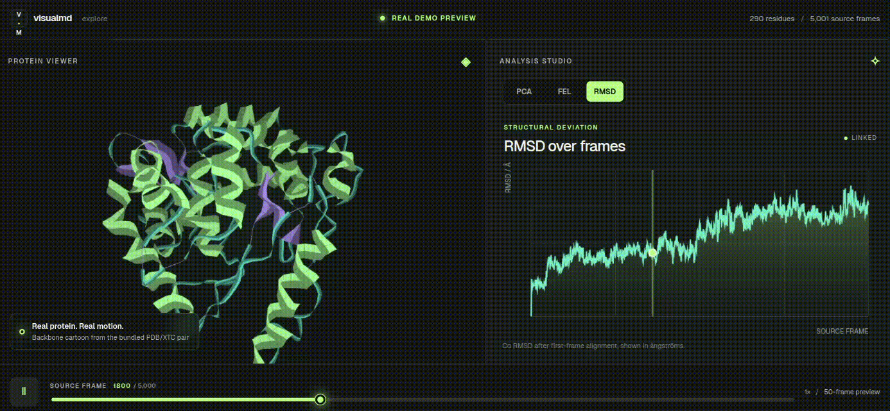
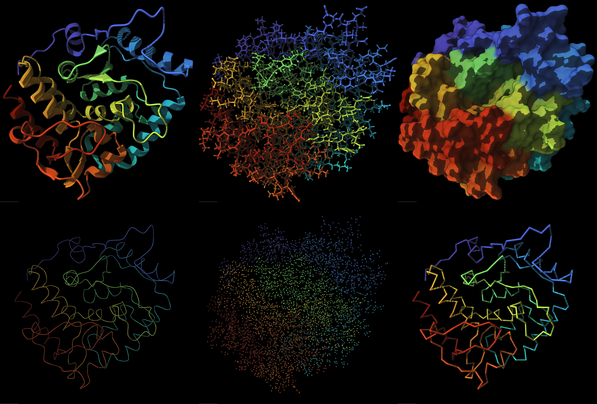
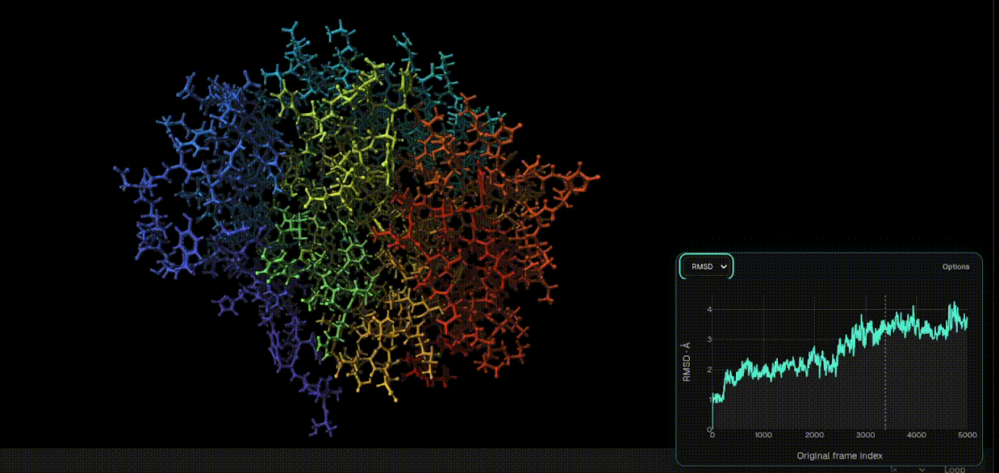
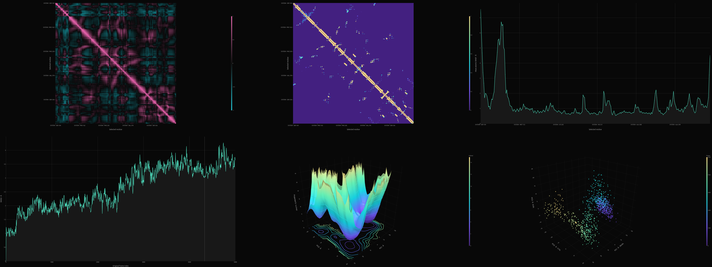

<div align="center">
  
</div>
<p align="center">
  
</p>

<div align="center">
  
[](https://github.com/Eswar-mse/visualmd/releases/tag/v0.2.1-preview)
[](#install)
[](#privacy)
[](#license)

[](https://www.python.org/)
[](https://www.mdanalysis.org/)
[](https://numpy.org/)
[](https://scipy.org/)
[](https://fastapi.tiangolo.com/)
[](https://molstar.org/)
[](https://plotly.com/javascript/)
[](https://vite.dev/)

[](https://visualmd.pages.dev/)
[](https://github.com/Eswar-mse/visualmd/releases/tag/v0.2.1-preview)
[](DOCUMENTATION.md)

</div>

<div align="center">
<h3>A Unified Workspace for Molecular Dynamics </h3>


**VisualMD** is a local-first molecular dynamics visualization and exploration workspace that brings protein structures, simulation trajectories, and analytical results together in one interactive environment. Instead of switching between multiple applications to inspect structures, navigate trajectories, and interpret simulation data, VisualMD connects these activities within a unified workspace.


### Core Capabilities

**Interactive Visualization:** Explore protein structures and conformational changes frame by frame.

**Integrated Analysis:** Examine RMSD, RMSF, radius of gyration, contacts, DCCM, PCA, and free-energy landscapes.

**Connected Exploration:** Relate analytical observations to their corresponding molecular conformations.

**Flexible Workflow:** Configure visualization and analysis parameters, and export scientific figures, data, and portable sessions.

**Local-First:** Work with molecular dynamics data directly on your Linux system.

</div>


<div align="center">
<h3> A Visual Preview </h3>
Glimpse of VisualMD through this short visual presentation, and the vision behind the project.


</div>

> The visuals shown are illustrative representations created for the website and project presentation. They are not screen recordings of the actual application interface and should not be interpreted as demonstrations of implemented functionality or scientific results.


<div align="center">
<h3> Installation </h3>
</div>

> **Linux x86_64 only** for `v0.2.1-preview`. No system Python or Node.js is needed; the archive bundles its own runtime. The first `./install.sh` needs internet to fetch pinned scientific packages.

Download **both** files from the [v0.2.1-preview release](https://github.com/Eswar-mse/visualmd/releases/tag/v0.2.1-preview) into one folder, then:

```bash
sha256sum --check visualmd-linux-x86_64-0.2.1-preview.tar.gz.sha256
tar -xzf visualmd-linux-x86_64-0.2.1-preview.tar.gz
cd visualmd-linux-x86_64-0.2.1-preview
./install.sh
visualmd
```

`visualmd` starts the local service on a free port and opens your browser. Keep the terminal open; **Ctrl+C** stops it. Keep the extracted folder, because the `visualmd` command points into it. If the command is not found, run `./visualmd` from that folder.

Choose **Explore the real demo** on the opening screen to try it without any files of your own. Troubleshooting and full details are in the [documentation](DOCUMENTATION.md#download-install-and-launch).

<details>
<summary>Release checksum</summary>

SHA-256 for `visualmd-linux-x86_64-0.2.1-preview.tar.gz`:

```
1f88e39379f2b07755eee1a2ff870a69a9d3bf76d4cc5a16b323b502e392f5f5
```

Verify against the `.sha256` file shipped with the release.

</details>


<div align="center">
<h3>Explore & Analyze </h3>
</div>

<h3> Molecular Visualisation</h3>

Inspect molecular architecture, and switch between structural representations to understand the organization of your system.
<div>&nbsp;</div>


**Includes**: Interactive 3D structures · Cartoon and atom representations · Residue inspection · Molecular surfaces

<div>&nbsp;</div>
<h3> Trajectory Exploration</h3>

Navigate molecular dynamics trajectories frame by frame and observe how protein conformations evolve over simulation time. Investigate structural changes and explore different conformational states interactively.
<div>&nbsp;</div>


**Includes**: Frame-by-frame navigation · Trajectory playback · Structural alignment · Conformational inspection
<div>&nbsp;</div>

<h3> Molecular Dynamics Analysis</h3>

Investigate structural stability, flexibility, residue interactions, and collective molecular motions through integrated analytical tools and visual representations.
<div>&nbsp;</div>


**Includes**: RMSD · RMSF · Radius of gyration · Residue contacts · DCCM · PCA · Free-energy landscapes
<div>&nbsp;</div>


<div align="center">
<h3> Real molecular visualization, powered by Mol* </h3>
</div>


<div align="center">

<h3>Analyses</h3>

[](DOCUMENTATION.md#rmsd)
[](DOCUMENTATION.md#rmsf)
[](DOCUMENTATION.md#radius-of-gyration)
[](DOCUMENTATION.md#pca)
[](DOCUMENTATION.md#free-energy-landscape)
[](DOCUMENTATION.md#residue-centre-contacts)
[](DOCUMENTATION.md#dccm)
[](DOCUMENTATION.md#sasa)
[](DOCUMENTATION.md#secondary-structure)
[](DOCUMENTATION.md#hydrogen-bonds)
[](DOCUMENTATION.md#protein-ligand-distances)

**Per-analysis input notes are in the [documentation](DOCUMENTATION.md#run-and-interpret-analyses).**

</div>


<a id="license"></a>
<div align="center">
<h3>License</h3>

VisualMD is **free to use, but not open source.** The VisualMD Preview End User License grants no-charge use of official, unmodified releases for personal, educational, research and internal commercial purposes. Modification, redistribution, resale and offering VisualMD as a hosted service are restricted. Third-party libraries keep their own licenses; you keep the rights to your own inputs and outputs. The governing terms are in `LICENSE.txt` inside the download.

This public repository holds the launch website, documentation, release information and issue tracker. The application source is private.
</div>


<div align="center">
<h3> Preview status</h3>

`v0.2.1-preview` is the first public release. The author has verified the downloaded package on a Linux workstation with the demo, their own PDB/XTC data, offline use after setup, surface playback, Legend view, and Legend PNG/MP4 export.
</div>

Still open, and tracked on the [public project board](https://github.com/users/Eswar-mse/projects/1):


- Clean installs on Ubuntu and Fedora
- A real 25,000-30,000-frame benchmark at full atom detail
- Dependency, security and license review
- More format, browser and GPU test coverage
- Accessibility and responsive layout
- Windows and macOS packages (not released yet)


<div align="center">

<h3>Documentation</h3>

Everything beyond this page lives in one place: **[DOCUMENTATION.md](DOCUMENTATION.md)**

[](DOCUMENTATION.md#how-visualmd-works)
[](DOCUMENTATION.md#prepare-a-trajectory-correctly)
[](DOCUMENTATION.md#run-and-interpret-analyses)
[](DOCUMENTATION.md#large-files-limits-and-storage)
[](DOCUMENTATION.md#troubleshooting)
[](DOCUMENTATION.md#frequently-asked-questions)
[](DOCUMENTATION.md#current-preview-limitations)

[](https://github.com/Eswar-mse/visualmd/releases)
[](https://github.com/Eswar-mse/visualmd/issues)
[](https://github.com/users/Eswar-mse/projects/1)

When reporting a bug, include the VisualMD version, Linux distribution, browser and GPU, topology/trajectory formats, approximate atom/residue/frame counts, exact steps and error text, and whether the bundled demo reproduces it. Please do not post confidential data.

</div>


<div align="center">
<h3> Built with</h3>


[](https://docs.pydantic.dev/)
[](https://www.uvicorn.org/)
[](https://developer.mozilla.org/docs/Web/HTML)
[](https://developer.mozilla.org/docs/Web/CSS)
[](https://developer.mozilla.org/docs/Web/JavaScript)
[](https://vercel.com/font)
[](https://phosphoricons.com/)
[](https://visualmd.pages.dev/)
[](https://github.com/Eswar-mse/visualmd/releases/tag/v0.2.1-preview)

</div>


<div align="center">
<h3> Cite</h3>

If VisualMD helps your work, please cite it. GitHub's **Cite this repository** button (from [`CITATION.cff`](CITATION.cff)) gives BibTeX and APA.
</div>

```bibtex
@software{moparti_visualmd_2026,
  author  = {Moparti, Sri Venkata Satya Sai Eswar},
  title   = {{VisualMD}: a local-first molecular dynamics exploration workspace},
  version = {0.2.1-preview},
  year    = {2026},
  url     = {https://github.com/Eswar-mse/visualmd},
  note    = {Linux x86\_64 preview release}
}
```

Please also cite the libraries you rely on, notably [MDAnalysis](https://www.mdanalysis.org/pages/citations/) and [Mol\*](https://molstar.org/).


<div align="center">
<h3>Author and contact</h3>
</div>

**Sri Venkata Satya Sai Eswar Moparti**

[ORCID](https://orcid.org/0009-0005-4635-7368) · [Google Scholar](https://scholar.google.com/citations?user=Bzc45zwAAAAJ&hl=en) · [msaieswar2002@gmail.com](mailto:msaieswar2002@gmail.com)

&copy; Sri Venkata Satya Sai Eswar Moparti. All rights reserved except as granted by the VisualMD Preview End User License.
