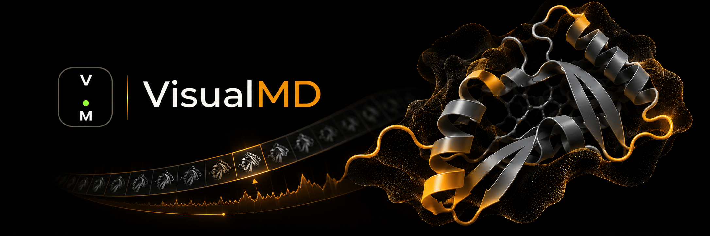

<div align="center">
  
</div>
<p align="center">
  
</p>

<div align="center">
  
[](https://github.com/Eswar-mse/visualmd/releases/tag/v0.2.1-preview)
[](#install)
[](#privacy)
[](#license)

[](https://www.python.org/)
[](https://www.mdanalysis.org/)
[](https://numpy.org/)
[](https://scipy.org/)
[](https://fastapi.tiangolo.com/)
[](https://molstar.org/)
[](https://plotly.com/javascript/)
[](https://vite.dev/)

[](https://visualmd.pages.dev/)
[](https://github.com/Eswar-mse/visualmd/releases/tag/v0.2.1-preview)
[](DOCUMENTATION.md)

</div>

<div align="center">
<h3>A Unified Workspace for Molecular Dynamics </h3>


**VisualMD** is a local-first molecular dynamics visualization and exploration workspace that brings protein structures, simulation trajectories, and analytical results together in one interactive environment. Instead of switching between multiple applications to inspect structures, navigate trajectories, and interpret simulation data, VisualMD connects these activities within a unified workspace.


### Core Capabilities

**Interactive Visualization:** Explore protein structures and conformational changes frame by frame.

**Integrated Analysis:** Examine RMSD, RMSF, radius of gyration, contacts, DCCM, PCA, and free-energy landscapes.

**Connected Exploration:** Relate analytical observations to their corresponding molecular conformations.

**Flexible Workflow:** Configure visualization and analysis parameters, and export scientific figures, data, and portable sessions.

**Local-First:** Work with molecular dynamics data directly on your Linux system.

</div>

<div align="center">
<h3> A Visual Preview </h3>
Get a glimpse of VisualMD through this short visual presentation, introducing its design language, molecular visualization concepts, and the vision behind the project.


</div>

> The visuals shown are illustrative representations created for the website and project presentation. They are not screen recordings of the actual application interface and should not be interpreted as demonstrations of implemented functionality or scientific results.

## Install

> **Linux x86_64 only** for `v0.2.1-preview`. No system Python or Node.js is needed; the archive bundles its own runtime. The first `./install.sh` needs internet to fetch pinned scientific packages.

Download **both** files from the [v0.2.1-preview release](https://github.com/Eswar-mse/visualmd/releases/tag/v0.2.1-preview) into one folder, then:

```bash
sha256sum --check visualmd-linux-x86_64-0.2.1-preview.tar.gz.sha256
tar -xzf visualmd-linux-x86_64-0.2.1-preview.tar.gz
cd visualmd-linux-x86_64-0.2.1-preview
./install.sh
visualmd
```

`visualmd` starts the local service on a free port and opens your browser. Keep the terminal open; **Ctrl+C** stops it. Keep the extracted folder, because the `visualmd` command points into it. If the command is not found, run `./visualmd` from that folder.

Choose **Explore the real demo** on the opening screen to try it without any files of your own. Troubleshooting and full details are in the [documentation](DOCUMENTATION.md#download-install-and-launch).

<details>
<summary>Release checksum</summary>

SHA-256 for `visualmd-linux-x86_64-0.2.1-preview.tar.gz`:

```
1f88e39379f2b07755eee1a2ff870a69a9d3bf76d4cc5a16b323b502e392f5f5
```

Verify against the `.sha256` file shipped with the release.

</details>

## What you can do

### One connected workspace

A resizable protein panel and analysis panel share the selected frame and residues. Click a point in a time plot, PCA cloud or sampled landscape to inspect that frame; click residue-aware plots such as RMSF to highlight the structure.

<!-- ASSET: assets/linked-click.gif (click a point on RMSD/PCA; the viewer jumps to that frame) -->


### Legend view: protein first, plot in the corner

The protein fills the workspace on black while a smaller live plot advances with playback. Export the same composition as PNG or MP4.

<table>
<tr>
<td width="50%">

<!-- ASSET: assets/legend-view.png -->


</td>
<td width="50%">

<!-- ASSET: assets/legend-export.gif (Legend playing, then the exported MP4 as a loop) -->


</td>
</tr>
</table>

### Real molecular visualization, powered by Mol\*

Cartoon, backbone, ball-and-stick, spacefill, lines, points, B-factor putty and molecular surface. Surfaces come in soft, matte, glossy, glass, frosted, metallic and clay finishes, with independent shadow, cavity-shading and outline controls. Viewer backgrounds: black, midnight, white, theme-matched, custom or transparent.

<!-- ASSET: assets/surfaces.png (grid of glass / metallic / frosted / clay finishes) -->


### Residue tools for pocket inspection

Search and tick residues by number, name, chain or segment, then isolate them in the viewer. Surfaces are recalculated from visible atoms only. Optional residue-number restoration maps a trajectory renumbered from 1 back to biological numbering, with the mapping recorded in exports.

<!-- ASSET: assets/residue-pocket.gif (search residues, tick, isolate a pocket) -->


### Dark and light themes

The dark theme is deliberately near-black so neon scientific colours stand out. A light theme is one click away.

<!-- ASSET: assets/light-theme.png (same view as the hero, light theme) -->


## Analyses

| Analysis | What it gives you |
| --- | --- |
| RMSD | Structural deviation over retained frames |
| RMSF | Per-residue fluctuation |
| Radius of gyration | Compactness over time |
| PCA | Dominant motion as a 2D or 3D point cloud |
| Free-energy landscape | Exploratory occupancy-derived landscape, 2D or 3D |
| Residue-centre contacts | Contacts under a chosen cutoff |
| DCCM | Residue displacement correlation |
| SASA | Solvent-accessible area |
| Secondary structure | Three-state assignment (MDAnalysis DSSP) |
| Hydrogen bonds | Geometric donor-acceptor counts |
| Protein-ligand distances | Minimum heavy-atom distances |

<!-- ASSET: assets/fel-3d.png (3D PCA or FEL, neon on dark) -->


> **Read the landscape responsibly.** The free-energy landscape is an exploratory projection of sampled occupancy. It is **not** a potential-energy surface and not proof of convergence. Unweighted landscapes are blocked for trajectories declared as biased or enhanced sampling, because validated reweighting is not implemented. Per-analysis input notes are in the [documentation](DOCUMENTATION.md#run-and-interpret-analyses).

## Export

| You want | Use |
| --- | --- |
| A picture or video for a talk | **PNG** / **MP4**: protein, plot, split view, or Legend with a corner plot (1280×720 or 1920×1080; MP4 at 12, 24 or 30 fps, up to 600 sampled frames) |
| Numbers for a paper | **CSV** or **JSON** (settings and provenance included) |
| One frame as coordinates | **Selected-frame PDB** |
| Pick up where you left off | **`.visualmd`** portable session (stores inputs and recipes; results are **recomputed** on reopen) |

These are not interchangeable: images are pictures, CSV/JSON hold the numbers, and a session is a recipe. Details in the [documentation](DOCUMENTATION.md#export-images-video-and-data).

## Inputs and scale

- **Verified with real data:** PDB topology + XTC trajectory (including the bundled demo). PDB + DCD and reference-PDB alignment have test coverage.
- **Growing format support:** VisualMD offers a growing set of MDAnalysis-compatible readers (for example GRO, PSF, PRMTOP, TPR, MOL2, PQR; TRR, NetCDF and others). A recognised extension is not a guarantee that every file variant loads. See [compatibility notes](DOCUMENTATION.md#input-files-and-formats).
- **Large data path:** direct local transfer of trajectories up to 10 GiB (disk permitting); up to 30,000 retained frames, with larger prepared sets stored on disk and streamed to the browser on demand. A synthetic 30,000-frame API check has passed; a **real 25,000-30,000-frame browser/GPU benchmark is still open**, so treat these as limits, not measured smooth-playback promises.
- **Preparation:** frame range and stride, prepared atom selection, raw or processed input, source-frame or PDB alignment reference, periodic-boundary fragment unwrapping (when bonds and box data exist), and a memory preview that suggests a safe stride.

## The bundled demo

The demo is real data from the author's simulation: `demo.pdb` + `demo.xtc`, 290 residues, 4,640 atoms, 5,001 source frames (opened at stride 5, retaining 1,001 frames). Its detailed simulation protocol and equilibrium status are not established in this release, so derived landscapes should be read as exploratory. The website preview uses a reduced version of the same demo.

<a id="privacy"></a>

## Privacy

The analysis service listens on `127.0.0.1`. Files you open are processed on your computer and are not uploaded to the VisualMD website. There are no accounts, cloud sync or remote collaboration in this preview. After installation, normal use was verified offline on the author's Linux workstation. Temporary working data lives under `~/.cache/visualmd` by default (override with `VISUALMD_DATA_DIR`) and is removed on normal shutdown.

<a id="license"></a>

## License

VisualMD is **free to use, but not open source.** The VisualMD Preview End User License grants no-charge use of official, unmodified releases for personal, educational, research and internal commercial purposes. Modification, redistribution, resale and offering VisualMD as a hosted service are restricted. Third-party libraries keep their own licenses; you keep the rights to your own inputs and outputs. The governing terms are in `LICENSE.txt` inside the download.

This public repository holds the launch website, documentation, release information and issue tracker. The application source is private.

## Preview status

`v0.2.1-preview` is the first public release. The author has verified the downloaded package on a Linux workstation with the demo, their own PDB/XTC data, offline use after setup, surface playback, Legend view, and Legend PNG/MP4 export.

Still open, and tracked on the [public project board](https://github.com/users/Eswar-mse/projects/1):

- Clean installs on Ubuntu and Fedora
- A real 25,000-30,000-frame benchmark at full atom detail
- Dependency, security and license review
- More format, browser and GPU test coverage
- Accessibility and responsive layout
- Windows and macOS packages (not released yet)

## Documentation

Everything beyond this page lives in one place: **[DOCUMENTATION.md](DOCUMENTATION.md)**.

| Jump to | |
| --- | --- |
| [How VisualMD works](DOCUMENTATION.md#how-visualmd-works) | Architecture and workflow |
| [Prepare a trajectory](DOCUMENTATION.md#prepare-a-trajectory-correctly) | Frames, stride, atoms, alignment, residue numbering |
| [Analyses](DOCUMENTATION.md#run-and-interpret-analyses) | What each analysis computes and how to read it |
| [Formats and limits](DOCUMENTATION.md#large-files-limits-and-storage) | Supported inputs, size limits, storage estimates |
| [Troubleshooting](DOCUMENTATION.md#troubleshooting) | Common problems and fixes |
| [FAQ](DOCUMENTATION.md#frequently-asked-questions) | Quick answers |
| [Current limitations](DOCUMENTATION.md#current-preview-limitations) | What the preview does not do yet |

Also: [Releases](https://github.com/Eswar-mse/visualmd/releases) · [Issues](https://github.com/Eswar-mse/visualmd/issues) · [Project board](https://github.com/users/Eswar-mse/projects/1)

When reporting a bug, include the VisualMD version, Linux distribution, browser and GPU, topology/trajectory formats, approximate atom/residue/frame counts, exact steps and error text, and whether the bundled demo reproduces it. Please do not post confidential data.

## Built with

Python · MDAnalysis · NumPy · SciPy · FastAPI · Pydantic · Uvicorn · Mol\* · Plotly.js · HTML/CSS/JavaScript (ES modules) · Vite · Geist · Phosphor Icons. Website on Cloudflare Pages; downloads on GitHub Releases.

## Cite

If VisualMD helps your work, please cite it. GitHub's **Cite this repository** button (from [`CITATION.cff`](CITATION.cff)) gives BibTeX and APA.

```bibtex
@software{moparti_visualmd_2026,
  author  = {Moparti, Sri Venkata Satya Sai Eswar},
  title   = {{VisualMD}: a local-first molecular dynamics exploration workspace},
  version = {0.2.1-preview},
  year    = {2026},
  url     = {https://github.com/Eswar-mse/visualmd},
  note    = {Linux x86\_64 preview release}
}
```

Please also cite the libraries you rely on, notably [MDAnalysis](https://www.mdanalysis.org/pages/citations/) and [Mol\*](https://molstar.org/).

## Author and contact

**Sri Venkata Satya Sai Eswar Moparti**

[ORCID](https://orcid.org/0009-0005-4635-7368) · [Google Scholar](https://scholar.google.com/citations?user=Bzc45zwAAAAJ&hl=en) · [msaieswar2002@gmail.com](mailto:msaieswar2002@gmail.com)

&copy; Sri Venkata Satya Sai Eswar Moparti. All rights reserved except as granted by the VisualMD Preview End User License.
